# Registering with Google Developers Console

The following shows how to get a register your app (or rather, your instance of gdocs-export) and get a Google API `client_id` and `client_secret` tokens.

The Google Developers Console API console seems to be always changing. The following steps were sufficient as of March 4, 2014.

---

* **CREATE NEW PROJECT:**
	1. Visit [https://console.developers.google.com/project](https://console.developers.google.com/project).
	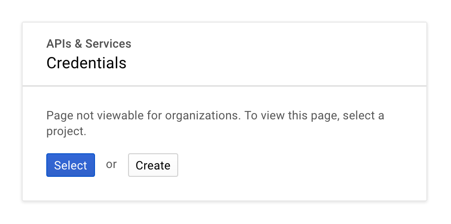
	1. Create new project.
	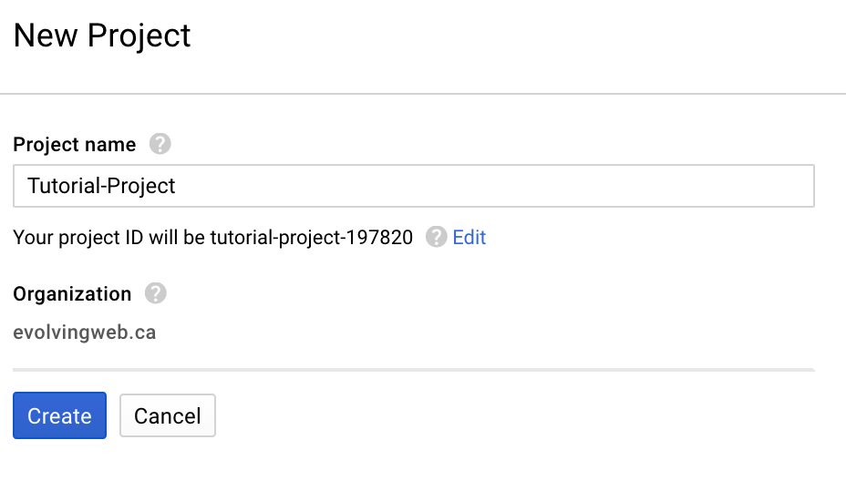
	
---
	
* **ENABLE GOOGLE DRIVE API:**
	1. In the next page, you will be prompted to `Enable the APIs you plan to use`. Follow this link.
	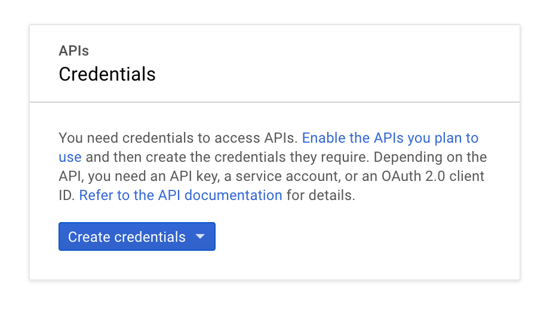
	1. Type `drive` in the search field, and then select the `Google Drive API`. 
	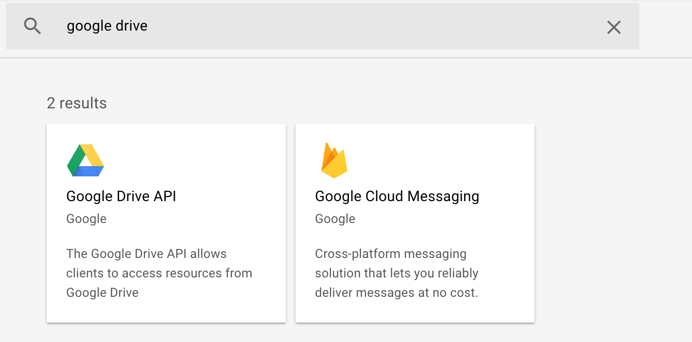
	1. Finally, you will be given the choice to `Enable` or `Try this API`, click `Enable`.
	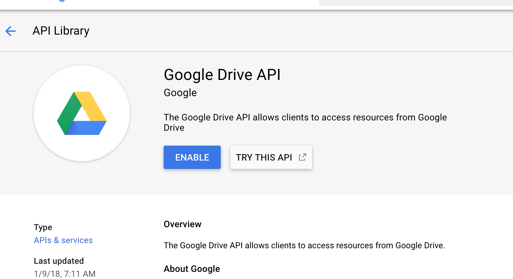
	
---

* **CREATE CREDENTIALS:**
	1. Once enabled, you will be prompted to `Create credentials`. Follow this link.
	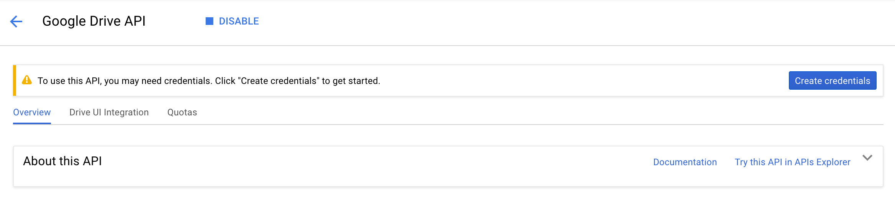
	1. You will now be given two drop-down menus and  a radio-button list. Fill them as in the picture (i.e.  `Google Drive API` | `Other UI` | `User Data` ). 
	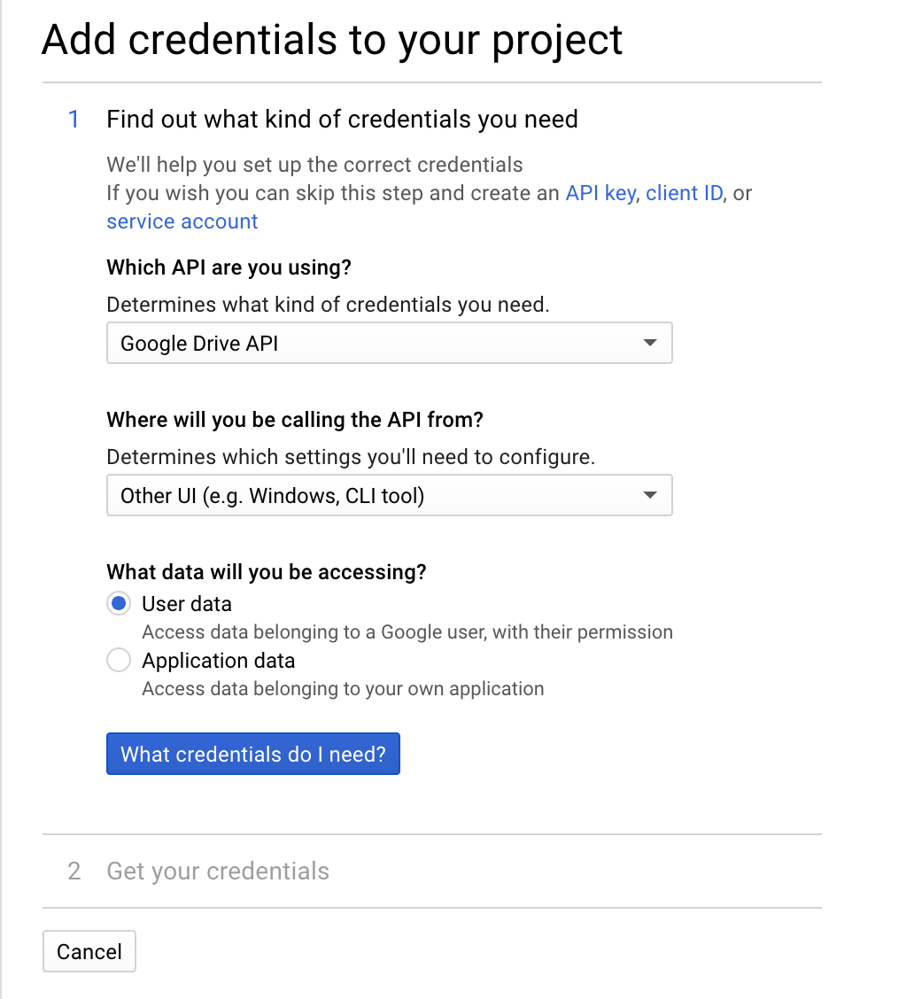
	1. Name your `OAuth 2.0 client ID` appropriately, and create it. Then name `Product name` appropriately, and press continue.
	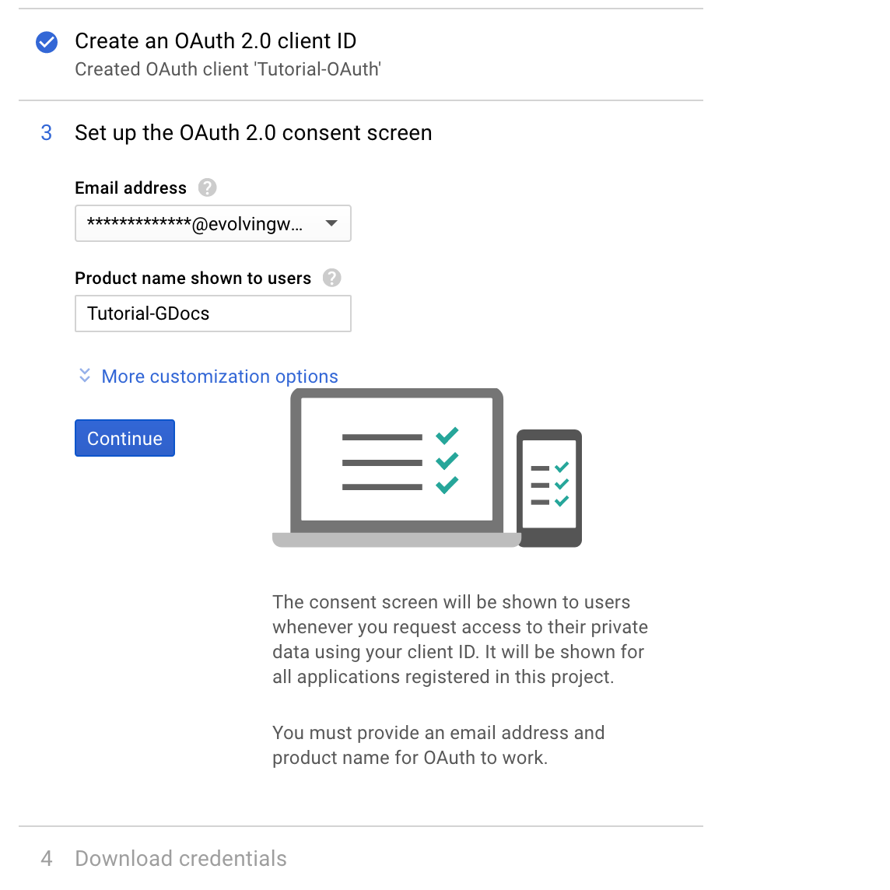
	1. Download your credentials in JSON format if needed, and press done.
	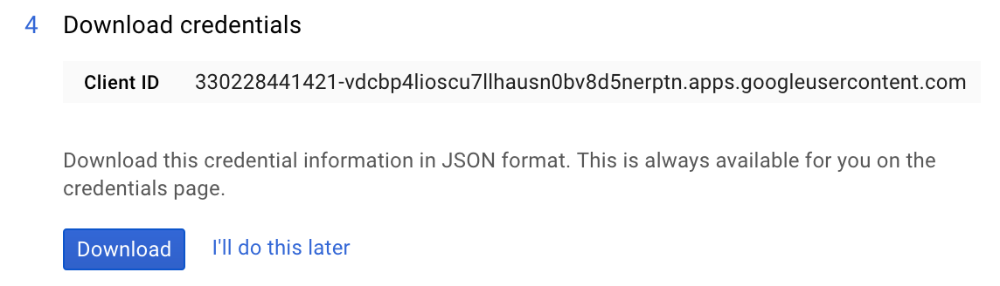
	
	---
	
* **ACCESS YOUR ID+PASS:**
	1. Simply click on the name of the OAuth ID you just you just created.
	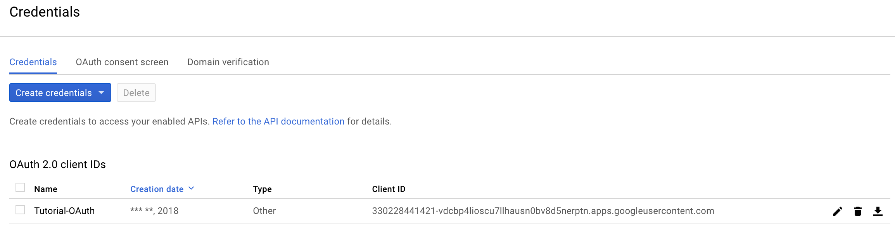
	1. The **CLIENT\_ID** and **CLIENT\_SECRET** you need are there for you to copy.
	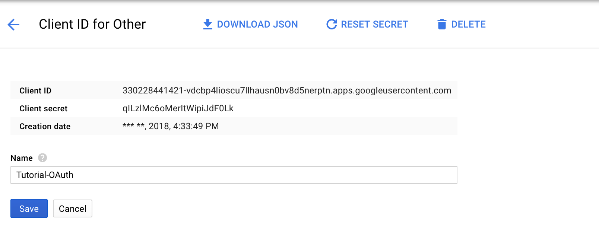
